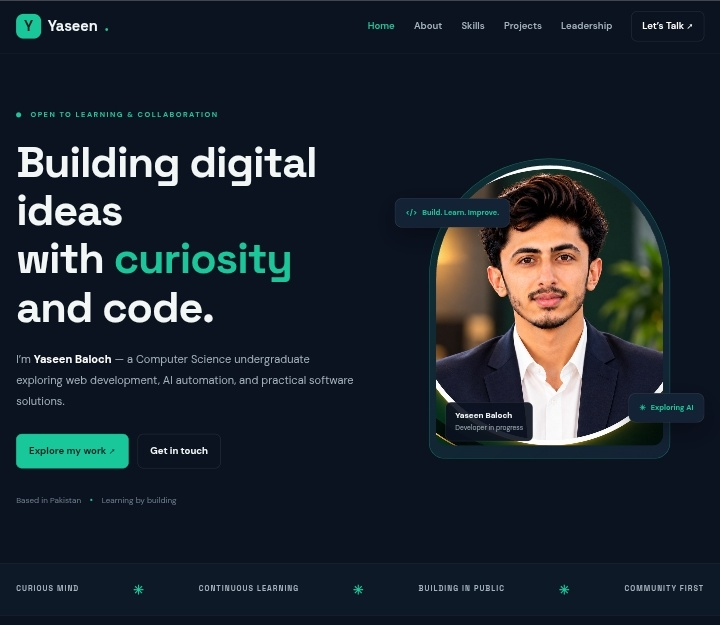
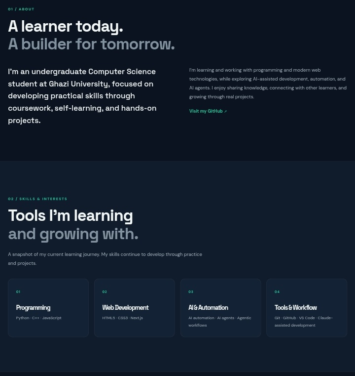
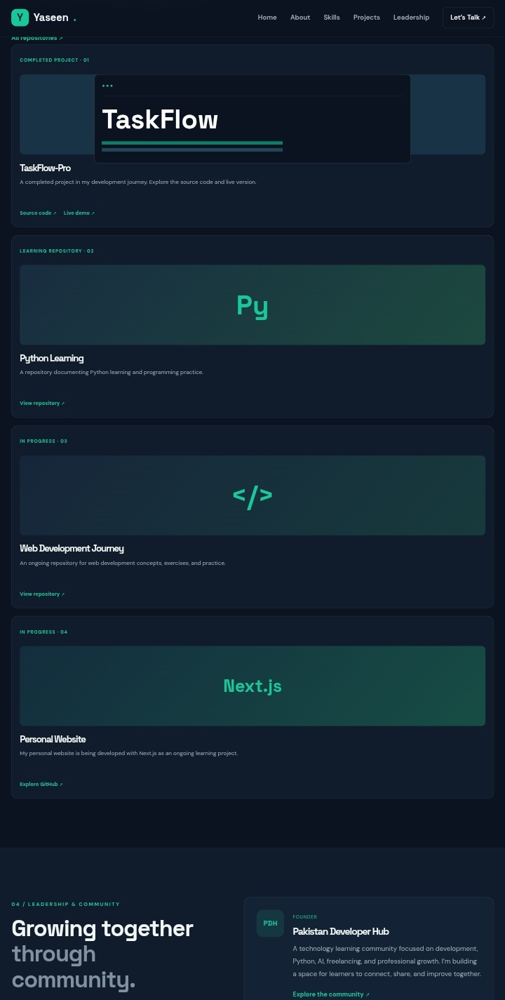

🚀 YASEEN BALOCH | PERSONAL BRAND LANDING PAGE

  

  <strong>Building My Digital Identity Through Code, Creativity & Innovation.</strong>
   
  A modern, responsive personal portfolio landing page built with HTML5 and CSS3.

  
  
  

  
  
  
  

---

✨ 01. About The Project

Personal Brand Landing Page is a modern frontend project developed as part of the Oasis Infobyte Web Development & Designing Internship — Level 1, Task 1.

The purpose of this project is to create a professional digital identity that introduces my background, technical interests, development journey, selected projects, and community involvement.

Designed with a sophisticated Dark Navy & Emerald Green color palette, the website focuses on clean aesthetics, responsive layouts, intuitive navigation, and a professional user experience.

<blockquote>
  <strong>My vision:</strong> Learn continuously, build meaningful projects, share knowledge, and grow as a Software Engineer.
</blockquote>🔗 02. Explore The Project

  

  

  

🖼️ 03. Project Preview

  <strong>01 — Homepage</strong>
   
  

  <strong>02 — About & Skills</strong>
   
  

  <strong>03 — Projects & Contact</strong>
   
  

🎯 04. Key Features

<table>
  <tr>
    <td width="50%">
      <h3>🧭 Smart Navigation</h3>
      Sticky header, section links, responsive mobile navigation.
    </td>
    <td width="50%">
      <h3>👨‍💻 Personal Introduction</h3>
      Hero section, profile image, professional headline and CTAs.
    </td>
  </tr>
  <tr>
    <td>
      <h3>🙋 About Me</h3>
      Educational background, interests and development journey.
    </td>
    <td>
      <h3>⚡ Skills & Interests</h3>
      Programming, web development and AI automation.
    </td>
  </tr>
  <tr>
    <td>
      <h3>🚀 Selected Projects</h3>
      A showcase of learning projects and development work.
    </td>
    <td>
      <h3>🤝 Leadership</h3>
      Pakistan Developer Hub community involvement.
    </td>
  </tr>
  <tr>
    <td>
      <h3>📱 Responsive Layout</h3>
      Flexible layouts for mobile, tablet and desktop.
    </td>
    <td>
      <h3>📬 Contact & Social Links</h3>
      Direct links to professional and communication platforms.
    </td>
  </tr>
</table>🛠️ 05. Technology Stack

  

Technology| Role
HTML5| Semantic structure and content
CSS3| Styling and visual design
Flexbox| Flexible alignment and layouts
CSS Grid| Structured content layouts
Media Queries| Responsive behavior
Google Fonts| DM Sans & Space Grotesk

Architecture: Static Frontend Website
JavaScript: Not required
Framework: None

🎨 06. Design System

  
  
  
  

Design Token| Hex Code| Purpose
Primary Background| "#0B1220"| Main background
Secondary Background| "#101B2B"| Alternate sections
Surface| "#142235"| Cards and surfaces
Emerald Accent| "#18C79A"| Highlights and buttons
Primary Text| "#F2F7F6"| Main text
Secondary Text| "#A4B2BD"| Supporting text

Typography: DM Sans & Space Grotesk

💼 07. Selected Projects

Some of the projects and learning initiatives featured on my personal website:

<table>
  <tr>
    <td width="50%">
      <h3>📋 TaskFlow-Pro</h3>
      
A productivity and task management project.

      <strong>Status:</strong> Completed
    </td>
    <td width="50%">
      <h3>🐍 Python Learning</h3>
      
A repository documenting Python learning and practice.

      <strong>Focus:</strong> Programming
    </td>
  </tr>
  <tr>
    <td width="50%">
      <h3>🌐 Web Development Journey</h3>
      
A collection of frontend learning and development work.

      <strong>Focus:</strong> Web Development
    </td>
    <td width="50%">
      <h3>⚛️ Personal Website — Next.js</h3>
      
An ongoing personal website development project.

      <strong>Status:</strong> In Progress
    </td>
  </tr>
</table>📂 08. Repository Structure

WebDev-L1-LandingPage/
│
├── assets/
│   └── profile.jpg
│
├── screenshots/
│   ├── homepage.png
│   ├── about-skills.png
│   └── projects-contact.png
│
├── index.html
├── style.css
└── README.md

File| Description
"index.html"| Main website structure
"style.css"| Website styling and responsive design
"assets/"| Profile photograph and image assets
"screenshots/"| Project preview images
"README.md"| Project documentation

📱 09. Responsive Implementation

The website uses CSS Flexbox, Grid, and Media Queries to adapt to different screen sizes.

- 🖥️ Desktop — Multi-column layouts and navigation.
- 📱 Mobile — Compact navigation and stacked content.
- 📟 Tablet — Flexible content arrangements.
- ♿ Accessibility — Semantic sections and descriptive image text.

⚙️ 10. Run Locally

This project is a static frontend website. No package installation or build process is needed.

Step 1 — Clone the Repository

git clone https://github.com/yaseenbalochpk/OIBSIP.git

Step 2 — Navigate to the Project

cd OIBSIP/WebDev-L1-LandingPage

Step 3 — Open in Browser

Open "index.html" in your preferred modern web browser.

🏢 11. Internship Information

  
  

Field| Details
Organization| Oasis Infobyte
Internship Track| Web Development & Designing
Level| Level 1
Task| Task 1 — Landing Page
Project Category| Personal Brand Website
Full Name| Muhammad Yaseen
Personal Brand| Yaseen Baloch

👨‍💻 12. About The Developer

  <strong>MUHAMMAD YASEEN</strong>
   
  <em>Yaseen Baloch — Aspiring Software Engineer</em>

Computer Science undergraduate with interests in programming, modern web development, AI automation, and technology entrepreneurship.

Passionate about continuous learning, practical implementation, knowledge sharing, and building meaningful digital solutions.

🤝 13. Connect With Me

  
  
  

  
  
  

---

  
  <strong>LEARN. BUILD. INNOVATE. GROW.</strong>
    
  Designed & Developed with ❤️ by <strong>Yaseen Baloch</strong>
   
  © 2026 Yaseen Baloch

